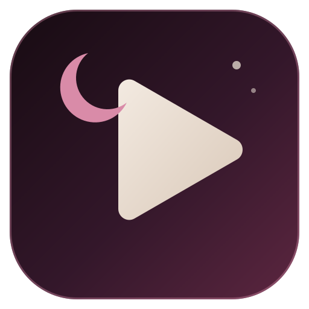
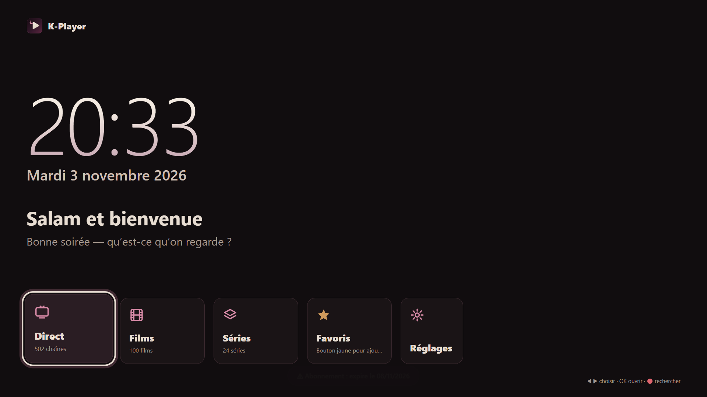
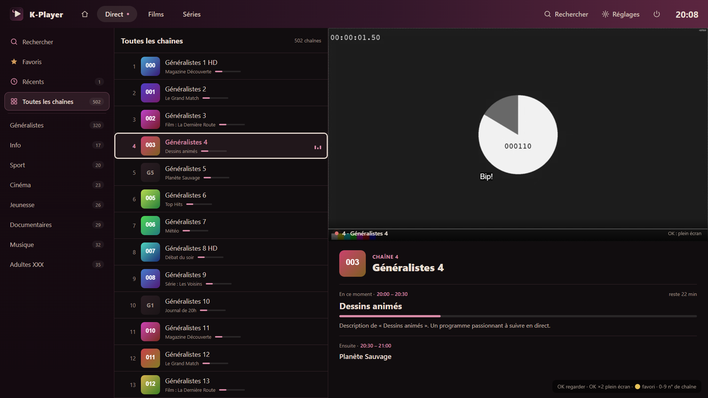
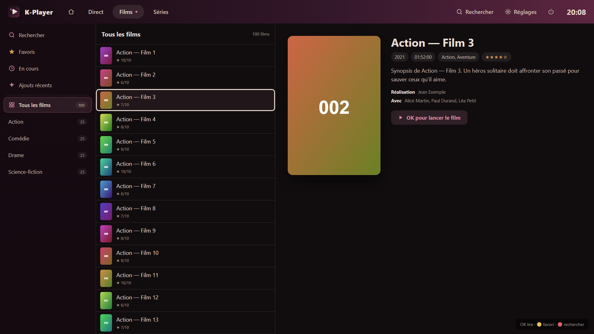
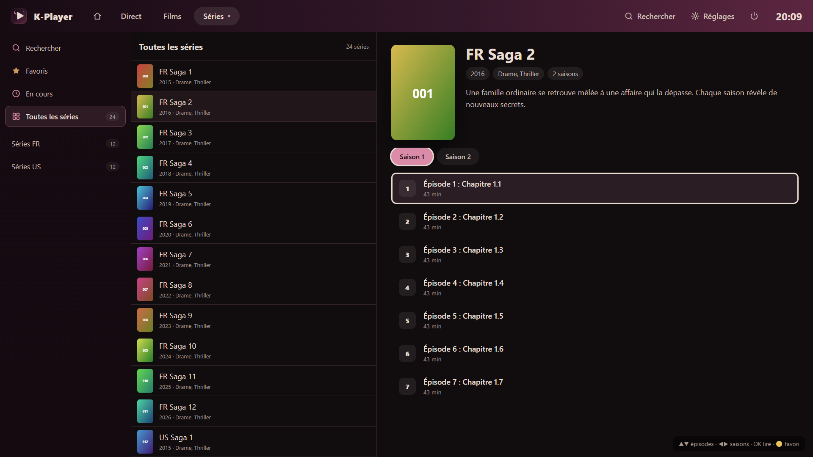

  

<h1 align="center">K-Player</h1>

  Lecteur IPTV (Xtream Codes) pour TV <b>LG webOS</b> et <b>Android TV / Google TV</b>, en thème « Nuit » et pensé pour la télécommande.

  
  &nbsp;
  

  

## ⬇️ Télécharger

| TV | Fichier |
|---|---|
| 📺 **LG webOS** | 👉 **[K-Player.ipk](https://github.com/Khenissi-Mohamed/Kplayer/releases/latest/download/K-Player.ipk)** |
| 🤖 **Android TV / Google TV** (Chromecast, Shield, Fire TV, box Android…) | 👉 **[K-Player.apk](https://github.com/Khenissi-Mohamed/Kplayer/releases/latest/download/K-Player.apk)** |

Toutes les versions sont sur la page [Releases](https://github.com/Khenissi-Mohamed/Kplayer/releases).

## 📺 Installer sur une TV LG (webOS)

1. Sur la TV, active le **mode développeur** : installe l'app *Developer Mode* depuis le LG Content Store et connecte-toi avec un compte LG développeur (gratuit).
2. Sur le PC, installe **[webOS Dev Manager](https://github.com/webosbrew/dev-manager-desktop/releases)** et ajoute ta TV.
3. Dans Dev Manager, va dans **Apps → Install** et choisis `K-Player.ipk`.
4. Lance **K-Player** depuis le menu de la TV.

> Le mode développeur doit être renouvelé régulièrement depuis l'app *Developer Mode*, sinon les apps installées sont désactivées.

## 🤖 Installer sur Android TV / Google TV

1. Sur la TV, installe l'app **Downloader** (by AFTVnews) depuis le Play Store.
2. Ouvre Downloader et tape l'adresse : `https://github.com/Khenissi-Mohamed/Kplayer/releases/latest/download/K-Player.apk`
3. Autorise l'installation d'apps inconnues pour Downloader quand la TV le demande, puis installe.
4. K-Player apparaît dans la liste des apps.

> Bonus Android : dans les **Options** (bouton vert ou Menu), « Ouvrir avec une autre app » lance la vidéo dans **VLC**, **MX Player** ou **Just Player** s'ils sont installés.

## 📱 Se connecter avec son téléphone

Au premier lancement, un **QR code** s'affiche à côté du formulaire :

1. Scanne-le avec l'appareil photo du téléphone.
2. Remplis le serveur, l'identifiant et le mot de passe.
3. Appuie sur **Envoyer à la TV** : la TV se connecte toute seule.

Les identifiants sont chiffrés sur le téléphone, et la clé n'existe que dans le QR code.

## ✨ Fonctions

- **Accueil** avec horloge, date et raccourcis (Reprendre, Direct, Films, Séries, Favoris, En cours).
- **Direct** avec programme TV (maintenant / ensuite), zapping ▲▼, mini-guide, saisie du numéro de chaîne et chaîne précédente.
- **Films et séries** avec fiches, saisons et reprise automatique là où tu t'étais arrêté.
- **Passer l'intro**, et **épisode suivant** proposé pendant le générique.
- **Sous-titres, langue audio**, taille des sous-titres, format d'image et vitesse.
- **3 lecteurs** (HLS.js, MPEG-TS, natif TV), avec bascule automatique si un flux ne passe pas.
- **Recherche, favoris** (bouton jaune) et récents.

| Direct | Films | Séries |
|---|---|---|
|  |  |  |

## 🎮 Télécommande

| Touche | Action |
|---|---|
| ▲ ▼ ◀ ▶ / OK | Naviguer / valider |
| OK ×2 sur une chaîne | Plein écran |
| CH+ / CH− | Chaîne suivante / précédente |
| 0-9 | Aller à une chaîne par son numéro |
| 🔴 Rouge | Rechercher |
| 🟢 Vert (ou Menu sur Android) | Options de lecture |
| 🟡 Jaune | Ajouter ou retirer des favoris |
| 🔵 Bleu | Chaîne précédente (direct) / épisode suivant (séries) |
| Retour | Revenir en arrière |

## ℹ️ À savoir

K-Player est **uniquement un lecteur** : il ne fournit aucune chaîne ni aucun contenu. Il faut ton propre abonnement IPTV compatible Xtream Codes.
