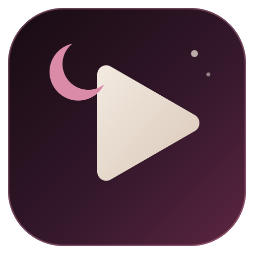
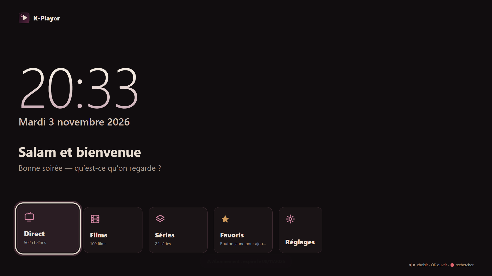
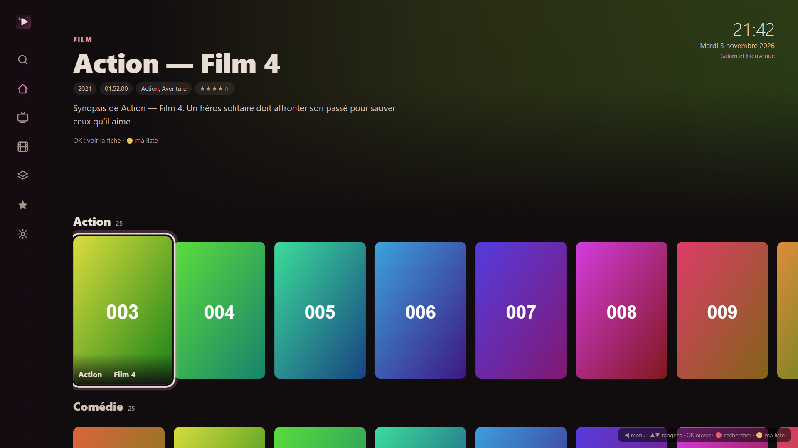
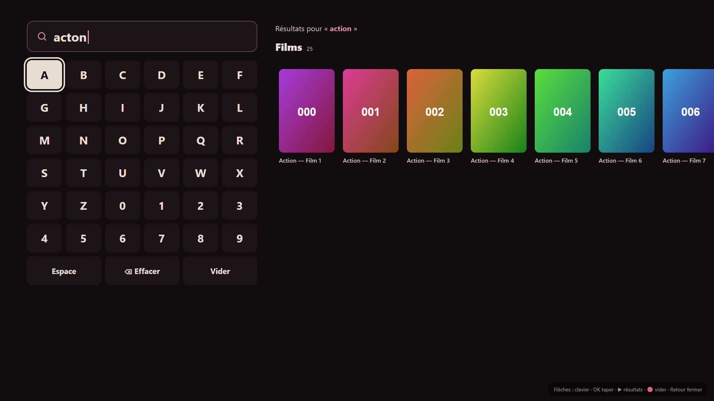
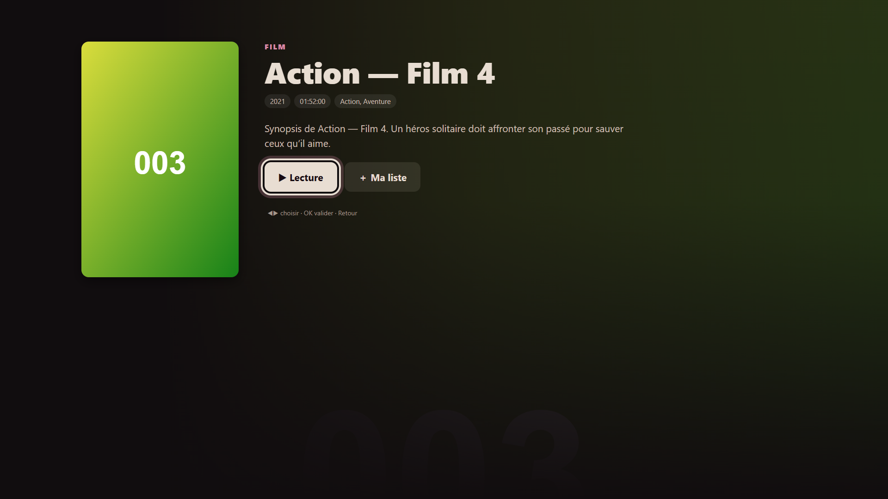
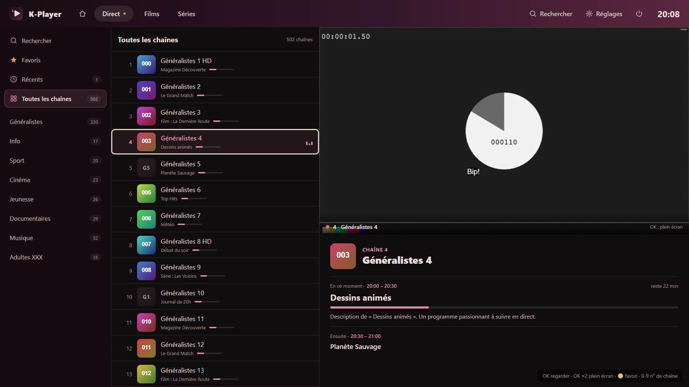
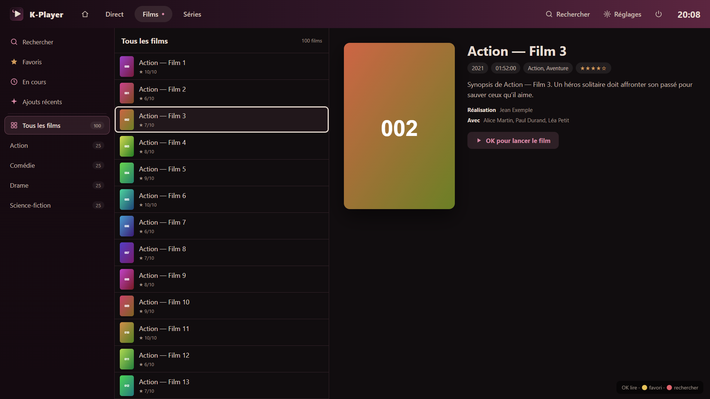
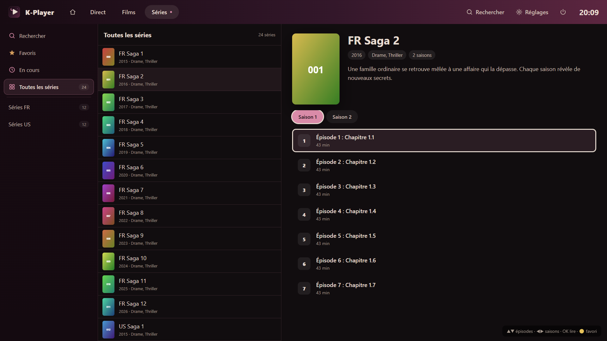

  

<h1 align="center">K-Player</h1>

  Lecteur IPTV (Xtream Codes) pour TV <b>LG webOS</b>, <b>Android TV / Google TV</b>, <b>téléphones et tablettes Android</b>, en thème « Nuit ».

  
  &nbsp;
  

  

## ⬇️ Télécharger

| Appareil | Fichier |
|---|---|
| 📺 **TV LG (webOS)** | 👉 **[K-Player.ipk](https://github.com/Khenissi-Mohamed/Kplayer/releases/latest/download/K-Player.ipk)** |
| 🤖 **Android TV / Google TV** (Chromecast, Shield, Fire TV, box Android…) | 👉 **[K-Player.apk](https://github.com/Khenissi-Mohamed/Kplayer/releases/latest/download/K-Player.apk)** |
| 📱 **Téléphone ou tablette Android** | 👉 **[K-Player.apk](https://github.com/Khenissi-Mohamed/Kplayer/releases/latest/download/K-Player.apk)** (le même fichier) |

Le même APK sert partout : K-Player choisit tout seul l'interface **TV** (télécommande) ou **mobile** (tactile).

Toutes les versions sont sur la page [Releases](https://github.com/Khenissi-Mohamed/Kplayer/releases).

## 📺 Installer sur une TV LG (webOS)

1. Sur la TV, active le **mode développeur** : installe l'app *Developer Mode* depuis le LG Content Store et connecte-toi avec un compte LG développeur (gratuit).
2. Sur le PC, installe **[webOS Dev Manager](https://github.com/webosbrew/dev-manager-desktop/releases)** et ajoute ta TV.
3. Dans Dev Manager, va dans **Apps → Install** et choisis `K-Player.ipk`.
4. Lance **K-Player** depuis le menu de la TV.

> Le mode développeur doit être renouvelé régulièrement depuis l'app *Developer Mode*, sinon les apps installées sont désactivées.

## 🤖 Installer sur Android TV / Google TV

1. Sur la TV, installe l'app **Downloader** (by AFTVnews) depuis le Play Store.
2. Ouvre Downloader et tape l'adresse : `https://github.com/Khenissi-Mohamed/Kplayer/releases/latest/download/K-Player.apk`
3. Autorise l'installation d'apps inconnues pour Downloader quand la TV le demande, puis installe.
4. K-Player apparaît dans la liste des apps.

> Avant une mise à jour, supprime l'ancien `K-Player.apk` dans l'onglet *Files* de Downloader : sinon il peut réinstaller l'ancien fichier.

## 📱 Installer sur un téléphone ou une tablette Android

1. Sur le téléphone, ouvre ce lien dans le navigateur : `https://github.com/Khenissi-Mohamed/Kplayer/releases/latest/download/K-Player.apk`
2. Ouvre le fichier téléchargé et autorise l'installation d'apps inconnues si Android le demande.
3. Au premier téléchargement d'une vidéo, accepte les notifications : elles affichent la progression.

## 🔑 Se connecter

Deux façons de se connecter, au choix en haut du formulaire :

- **Identifiants** : adresse du serveur, identifiant et mot de passe. Une fois le serveur utilisé sur un appareil, il est retenu : l'identifiant et le mot de passe suffisent ensuite.
- **Lien complet** : tout sur une ligne, par exemple le lien `get.php?username=…&password=…` donné par ton fournisseur.

Sur TV, un **QR code** permet aussi de tout remplir depuis le téléphone :

1. Scanne-le avec l'appareil photo du téléphone.
2. Remplis le serveur, l'identifiant et le mot de passe.
3. Appuie sur **Envoyer à la TV** : la TV se connecte toute seule.

Les identifiants sont chiffrés sur le téléphone, et la clé n'existe que dans le QR code.

## ✨ Fonctions

**Regarder**
- **Direct** avec programme TV (maintenant / ensuite), zapping, mini-guide, numéro de chaîne et chaîne précédente.
- **Guide TV** : grille des programmes chaînes × heures, jusqu'à 7 jours en arrière. Un programme passé se revoit en un clic (OK ou un tap), un programme en cours se regarde en direct ou depuis le début.
- **Replay** des chaînes qui ont des archives.
- **Films et séries** avec fiches, saisons et reprise automatique là où tu t'étais arrêté.
- **Passer l'intro** (repérée et apprise par série) et **épisode suivant** proposé pendant le générique.

**Lecture sur Android : tous les formats, tous les sons**
- Moteur **ExoPlayer** (celui des grandes applis Android TV) avec décodeur de son **FFmpeg** : MKV, MP4, AVI…, Dolby AC3 / E-AC3, DTS, TrueHD.
- **VLC** intégré en secours, automatiquement, si un fichier ne passe pas.
- Tout reste dans le lecteur K-Player : rien ne s'ouvre à côté, aucun réglage.
- Réserve de lecture adaptée aux films 4K et Full HD. Une chaîne qui coupe souvent passe toute seule sur ExoPlayer.

**Téléphones et tablettes**
- Interface tactile : onglets Accueil, Direct, Films, Séries, Téléchargés ; rangées qui défilent au doigt ; recherche avec le clavier du téléphone.
- Lecteur en paysage : un tap pour les commandes, double-tap pour −10 s / +10 s.

**Téléchargements hors connexion** (Android)
- Film, épisode ou saison entière, un fichier à la fois, avec reprise après coupure.
- Fichiers rangés dans **Films › K-Player** sur le téléphone : ils s'ouvrent aussi avec l'appli Fichiers ou VLC, même sans K-Player.
- Épisode vu jusqu'au bout : il est supprimé et le suivant se télécharge tout seul.
- **Sans internet**, K-Player s'ouvre directement sur les téléchargements.

**Interface**
- Deux affichages sur TV (Réglages → Affichage) : **Classique** (catégories, liste, aperçu) ou **K-Flix** (grand visuel, rangées de vignettes, « Tout voir » en grille avec aperçu des chaînes).
- **Plusieurs serveurs** : chacun garde ses favoris, reprises et historique.
- **Recherche instantanée** : dès la 1re lettre, partout ou seulement dans les chaînes, films ou séries ; fautes de frappe et accents tolérés.
- **Favoris** (bouton jaune) avec plusieurs listes de chaînes (Sport, Info…).
- **Sous-titres français en ligne** (Addic7ed, OpenSubtitles avec ta clé gratuite), calés automatiquement, avec synchro sur une réplique.
- **Journal de lecture** (Réglages) : lecteur utilisé, temps avant l'image, coupures et débit du serveur, pour comprendre un souci.

| K-Flix | Recherche | Fiche |
|---|---|---|
|  |  |  |

| Direct (classique) | Films (classique) | Séries (classique) |
|---|---|---|
|  |  |  |

## 🎮 Télécommande

| Touche | Action |
|---|---|
| ▲ ▼ ◀ ▶ / OK | Naviguer / valider |
| OK ×2 sur une chaîne | Plein écran |
| CH+ / CH− | Chaîne suivante / précédente |
| 0-9 | Aller à une chaîne par son numéro |
| 🔴 Rouge | Rechercher |
| 🟢 Vert (ou Menu sur Android) | Options de lecture (sous-titres, synchro, audio…) · replay sur une chaîne en K-Flix |
| 🟡 Jaune | Ajouter ou retirer des favoris |
| 🔵 Bleu | Chaîne précédente (direct) / épisode suivant (séries) |
| Retour | Revenir en arrière |

## ℹ️ À savoir

K-Player est **uniquement un lecteur** : il ne fournit aucune chaîne ni aucun contenu. Il faut ton propre abonnement IPTV compatible Xtream Codes. L'appli ne contient aucun serveur ni aucun compte : chacun saisit les siens.
